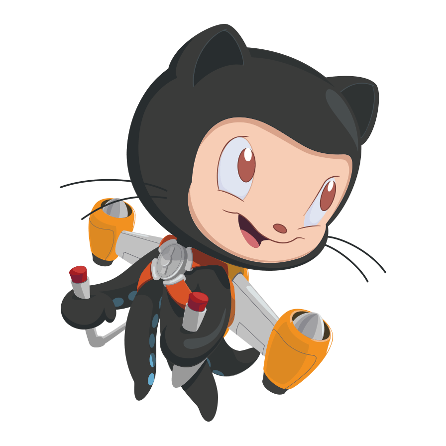

## Revisão: do primeiro workflow à entrega contínua



Você transformou um projeto inicial em uma entrega automatizada:

| Passo | Evidência do que você construiu |
| --- | --- |
| 1. Workflow | Evento, job, step e permissões declarados em YAML. |
| 2. Execução | Comentário no PR e logs do workflow Boas-vindas. |
| 3. CI | Falha investigada e testes verdes em duas versões do Node. |
| 4. Artefatos | O build foi baixado e conferido em outro job. |
| 5. Publicação | Site com seu título e um deployment no environment. |
| 6. Reuso (opcional, próximo desafio) | Você poderá reunir steps em uma composite action. As instruções estão logo abaixo da revisão; ela não é necessária para concluir os cinco passos. |

**[Abrir meu site]({{ site_url }})**

### O que você pode aplicar em outros projetos

- Limitar permissões de cada automação em vez de usar um token com acesso amplo.
- Consultar logs para distinguir uma falha de teste de um problema de configuração.
- Usar `needs` e artefatos para passar o mesmo resultado entre jobs.
- Separar a validação de um PR da publicação na branch principal.

### 🔐 Cadeia de suprimentos: o que seu CI já faz e o que falta

**Cadeia de suprimentos de software** é o conjunto de ferramentas e componentes de que seu projeto depende. Seu workflow usa código de outras pessoas, como as actions prontas. Por isso, além de funcionar, a receita precisa limitar acessos e cuidar dessas dependências.

| Boa prática | No seu CI |
| --- | --- |
| Permissão mínima para o `GITHUB_TOKEN` | ✅ `contents: read` no topo; `pages` e `id-token` só no job `deploy`. |
| Dados externos tratados como dados, não como código | ✅ `env` + `"$PR_URL"` no Passo 1. |
| Não deixar a credencial disponível para comandos Git posteriores ao checkout | ✅ `persist-credentials: false` nos checkouts. |
| Nada sensível em artefatos ou no site | ✅ `SITE_TITLE` é uma variável pública, não um secret. |
| Actions fixadas por **SHA completo** | ⚠️ Faltou: `@v7` é uma tag, e tags podem ser movidas. |
| Atualização automática das actions | ⚠️ Faltou: sem o Dependabot, as versões ficam paradas. |
| Revisão automática dos workflows | ➡️ Próximo passo: [actionlint](https://github.com/rhysd/actionlint), [zizmor](https://github.com/zizmorcore/zizmor) e o [CodeQL](https://docs.github.com/pt/code-security/code-scanning/introduction-to-code-scanning/about-code-scanning-with-codeql), que também analisa workflows. |

Uma **tag**, como `v7`, é um nome de versão que pode passar a apontar para outro commit. Um **SHA** é o identificador de um commit específico. Usar o SHA completo fixa aquela versão da action, em vez de seguir uma tag que pode mudar; ainda é necessário revisar o código e suas dependências. Organizações podem exigir isso com a política [Require SHA pinning](https://github.blog/changelog/2025-08-15-github-actions-policy-now-supports-blocking-and-sha-pinning-actions/). Leia o guia oficial de [uso seguro do GitHub Actions](https://docs.github.com/pt/actions/reference/security/secure-use).

<details>
<summary>✨ Bônus opcional: fixe uma action por SHA e ative o Dependabot (não avaliado)</summary>

**Faça este bônus depois de concluir o Passo 5.** Se também quiser fazer o Passo 6, finalize um bônus antes de começar o outro. Não mantenha as duas alterações em andamento ao mesmo tempo.

O **Dependabot** é uma automação do GitHub que propõe atualizações de dependências por meio de PRs. Você continuará responsável por revisar e integrar essas propostas.

1. No terminal do Codespaces, execute `git status`. Com **working tree clean**, atualize a `main` e crie a branch do bônus:

   ```bash
   git switch main
   git pull --ff-only
   git switch -c seguranca
   code .github/workflows/ci.yml
   ```

1. Abra a [página da release v7.0.1 do checkout](https://github.com/actions/checkout/releases/tag/v7.0.1) e clique no hash do commit ao lado da tag. Copie os **40 caracteres** do SHA que aparecem no endereço da página.
1. No editor, troque uma ocorrência de `uses: actions/checkout@v7` por `uses: actions/checkout@<SHA de 40 caracteres> # v7.0.1`. **Substitua todo o trecho `<SHA de 40 caracteres>`, incluindo `<` e `>`, pelo identificador copiado.** O comentário `# v7.0.1` ajuda na revisão. Salve o arquivo.
1. No terminal, execute `code .github/dependabot.yml`. Cole o conteúdo abaixo no arquivo e salve com **File → Save**:

   ```yaml
   version: 2
   updates:
     - package-ecosystem: github-actions
       directory: /
       schedule:
         interval: weekly
   ```

1. Registre e envie os dois arquivos:

   ```bash
   git add .github/workflows/ci.yml .github/dependabot.yml
   git commit -m "Fixar uma action e configurar Dependabot"
   git push -u origin seguranca
   ```

1. No GitHub, abra **Pull requests → New pull request**, escolha **base: main** e **compare: seguranca** e clique em **Create pull request**. Use o título `Atualizar seguranca das actions` e confirme em **Create pull request**.
1. Aguarde o **CI** ficar verde em **Checks**. Nesta branch, ele começa ao abrir o PR: `seguranca` não está na lista de branches do evento `push`.
1. Volte a **Conversation** e use **Merge pull request → Confirm merge**. O Dependabot lê a configuração da `main`; apenas criar o arquivo na branch do PR não o ativa. A agenda `weekly` significa uma verificação semanal, não uma garantia de PR imediato. Leia sobre o [Dependabot para actions](https://docs.github.com/pt/code-security/how-tos/secure-your-supply-chain/secure-your-dependencies/auto-update-actions).

Esse bônus não é avaliado e não bloqueia o desafio opcional do Passo 6. Se, depois do merge, o **Passo 6** comentar que precisa de um ajuste, ignore: ele só avalia a composite action.

</details>

### Para fechar: converse com a turma

1. Quando usar um **artefato** e quando usar **cache**?
1. Uma **composite action** e um **workflow reutilizável** resolvem o mesmo problema? Qual reaproveita steps e qual reaproveita jobs?
1. Por que `pages: write` e `id-token: write` ficam só no job `deploy`, e não no workflow inteiro?
1. O que poderia acontecer se o título de um PR fosse escrito direto em um `run`, como `echo "${{ github.event.pull_request.title }}"`?
1. O tutor deste exercício lê o seu YAML, mas nunca executa o código do seu repositório. Por que isso importa?

### Ao encerrar: pare o Codespaces

1. No terminal do Codespaces, execute `git status`. Confira se salvou, registrou e enviou as alterações da sua atividade. Se houver algo pendente que você não reconhece, peça ajuda antes de excluir qualquer coisa.
1. Abra o repositório no GitHub, escolha a branch em que trabalhou e confira os arquivos enviados.
1. Abra [Seus codespaces](https://github.com/codespaces), localize o ambiente deste exercício e clique em **… → Stop codespace**.
1. Se não pretende retomar o ambiente, pode usar **… → Delete**, mas apenas depois de conferir que não há trabalho salvo só nele. Para continuar o desafio depois, mantenha-o parado e clique no nome quando quiser retomar.

Fechar a aba não para o ambiente imediatamente. Parar interrompe o uso de processamento, mas o armazenamento continua sendo contabilizado enquanto o Codespaces existir. Consulte [como parar e retomar um codespace](https://docs.github.com/en/codespaces/developing-in-a-codespace/stopping-and-starting-a-codespace). Seu site no Pages continua publicado independentemente do Codespaces.

### Próximos passos

- [Proteção de branches e checks obrigatórios](https://docs.github.com/pt/repositories/configuring-branches-and-merges-in-your-repository/managing-protected-branches/about-protected-branches): um check verde, por si só, não bloqueia merges. Se configurar uma regra, escolha checks do projeto, não os workflows **Passo N** do tutor.
- [Workflows reutilizáveis](https://docs.github.com/pt/actions/how-tos/reuse-automations/reuse-workflows): `workflow_call` reutiliza jobs ou workflows completos; uma composite action reutiliza steps.
- [Criar actions JavaScript](https://github.com/skills/write-javascript-actions): aprofunde metadados, outputs e empacotamento.
- [Publicar imagens Docker](https://github.com/skills/publish-docker-images): leve a entrega ao GitHub Container Registry.
- [Artefatos entre workflows](https://github.com/skills/workflow-artifacts): avance para transferências entre execuções e aprovações.
- [IA em Actions](https://github.com/skills/ai-in-actions): combine contexto, inferência e uma ação sobre a resposta.
- [Deploy no Azure](https://github.com/skills/deploy-to-azure): explore uma entrega com infraestrutura e credenciais de nuvem.

Esses exercícios externos podem estar em inglês e ter pré-requisitos próprios. Eles não são necessários para concluir este hands-on.
