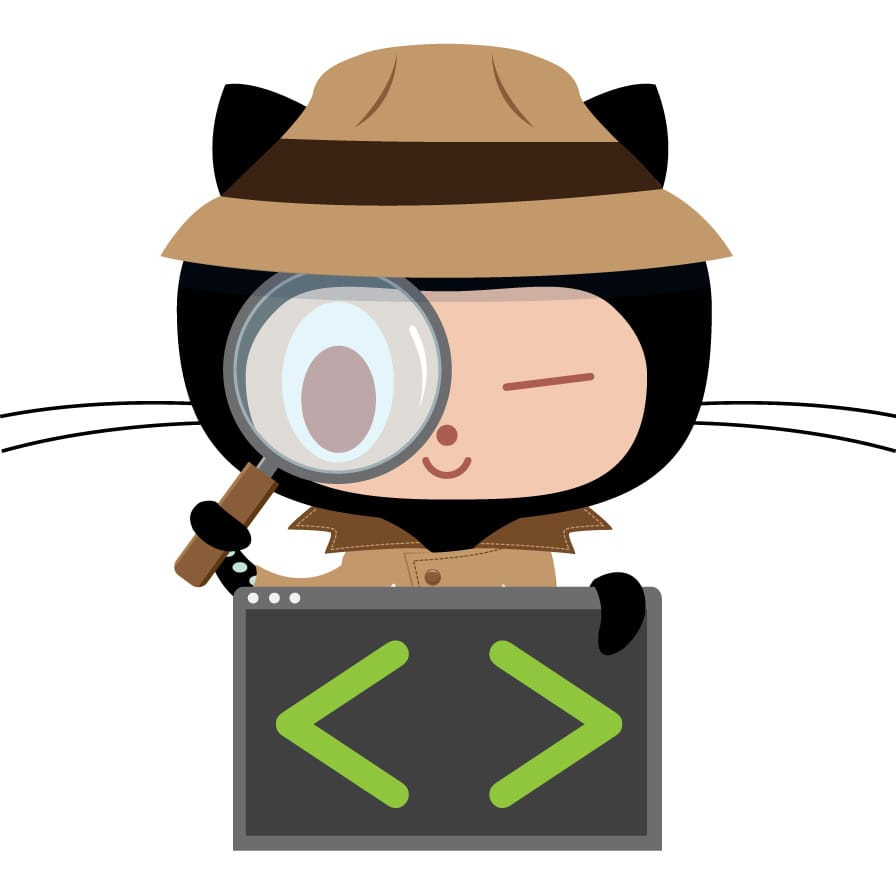

# GitHub Actions: do primeiro workflow à entrega contínua

👋 Olá, @diegoccastano-invillia! Aqui é a Mona. Seu exercício está pronto. Espero que você goste! 💚

O ritmo é seu: faça uma etapa por vez e faça uma pausa quando quiser. Nas etapas, vou verificar seu trabalho, compartilhar as próximas instruções e dar dicas quando precisar.

---

© GitHub, Inc. · [Código de Conduta](https://www.contributor-covenant.org/pt-br/version/2/1/code_of_conduct/) · [Licença MIT](LICENSE)
